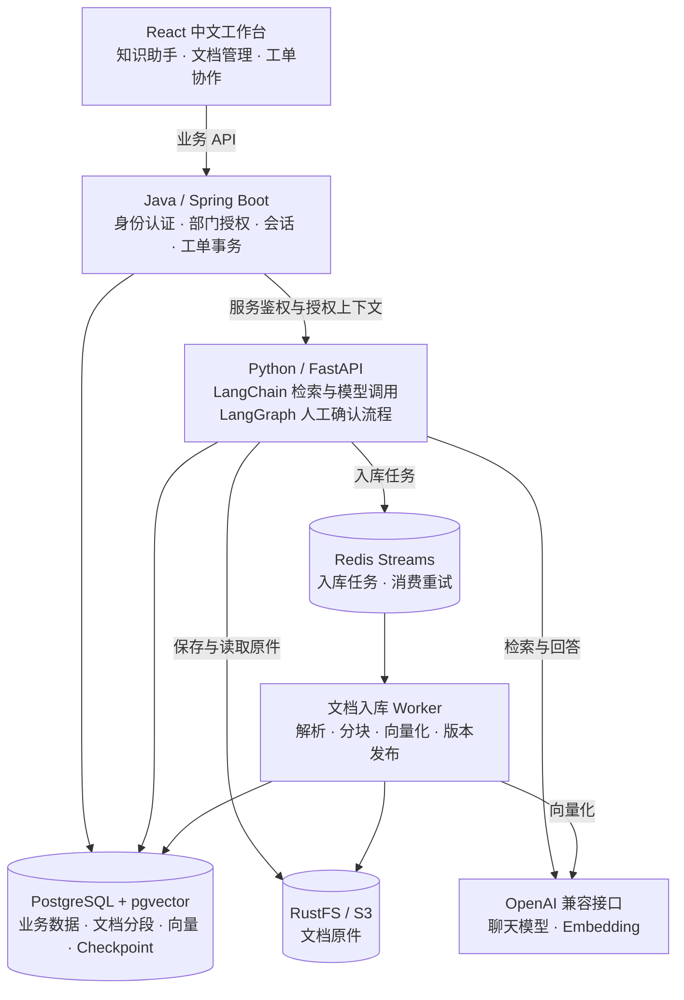
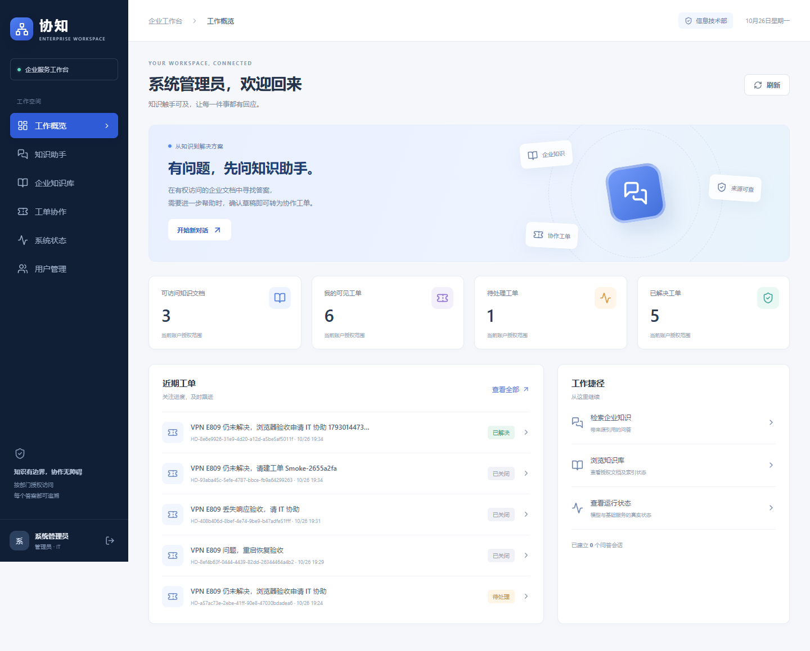
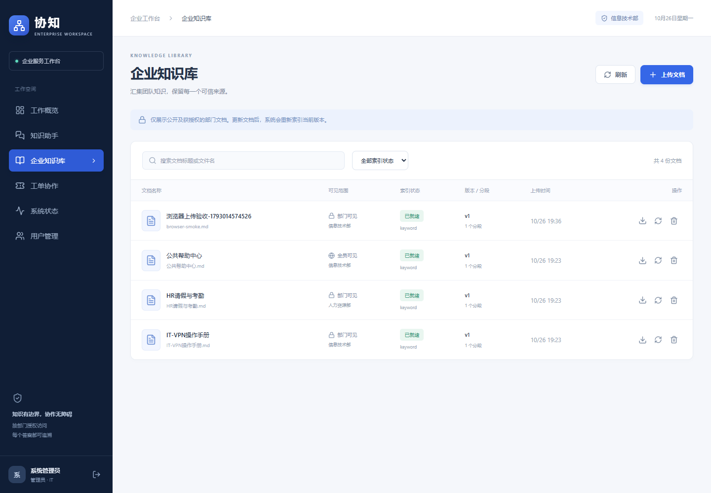
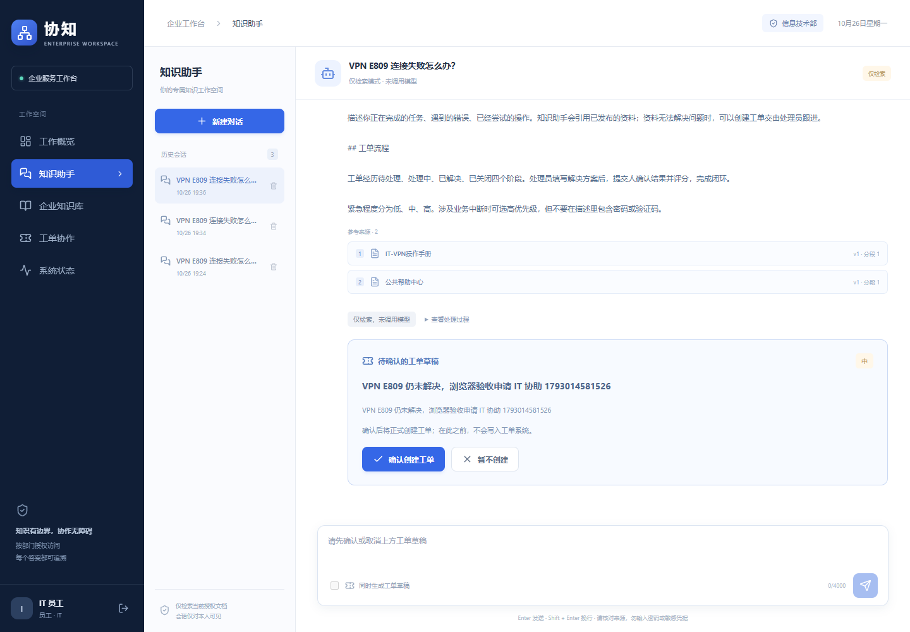
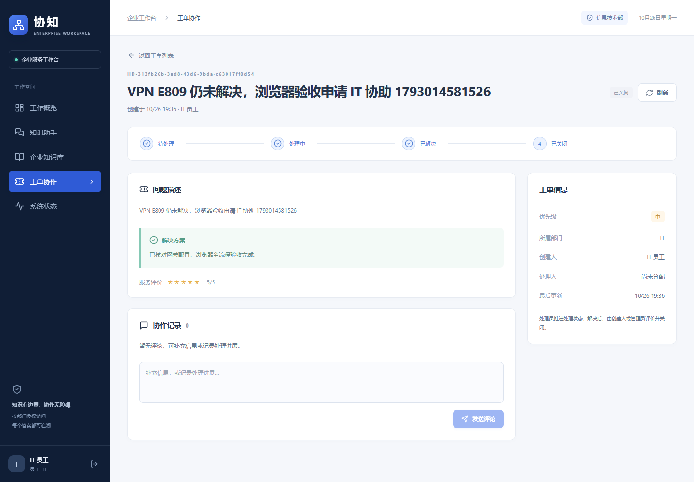

<div align="center">

# 协知 · Enterprise Helpdesk

**企业知识助手与工单协作平台**

基于 Spring Boot、LangChain / LangGraph 和 React，连接企业知识检索、来源引用与工单协作。


[功能特性](#功能特性) · [效果展示](#效果展示) · [快速开始](#快速开始) · [配套文档](#配套文档) · [常见问题](#常见问题)

</div>

---

## 项目介绍

协知（Enterprise Helpdesk）是一个面向企业内部服务场景的知识问答与工单协作平台。员工可以查询操作手册、制度说明和常见问题，查看回答所引用的文档；问题仍未解决时，可以在对话中准备工单草稿，经本人确认后交给处理员跟进，直到填写解决方案、评价并关闭。

项目围绕 **“上传知识 → 授权检索 → 引用回答 → 人工确认 → 工单处理”** 展开，适合学习 Java 与 Python 服务协作、RAG 应用和需要人工确认的 Agent 工作流。仓库包含中文工作台、示例知识文档、启动脚本与实战手册，可以在本机运行完整业务流程。

- **有权限的知识问答**：按角色和部门控制文档访问，检索前确定授权范围，历史回答也会重新校验引用权限。
- **有出处的回答**：展示文档、版本与原文片段；未配置聊天模型时明确使用“仅检索”模式。
- **可恢复的人工确认**：LangGraph 保存待确认流程，Java 通过事务与幂等约束创建工单。
- **完整的处理过程**：支持接单、评论、解决说明和评价关闭，让问答与后续协作衔接起来。

> 当前版本面向本机演示与学习。云模型适配已实现，现有验收主要覆盖“仅检索”模式及业务流程；真实云模型的连通性和生成质量仍需使用自己的配置验证。详见[验证记录](docs/verification.md)。

## 系统架构



浏览器只调用 Java 业务服务。Java 负责“谁能访问什么、哪些业务操作允许执行”；Python 负责“如何处理文档、检索证据和运行 AI 流程”。模型输出不会成为授权依据，也不会直接写入业务工单。

工单草稿通过 LangGraph `interrupt` 暂停，用户确认后由 Java 创建工单，再将结果交给图恢复执行。**Checkpoint 保存流程进度，数据库事务与唯一约束保证重复确认不会重复建单。** 两者分别处理流程恢复和业务一致性。

## 配套文档

仓库提供一份 17 章的[《协知实战手册》](docs/实战手册.md)，包含技术原理、源码入口、实践任务、故障恢复和面试问答。建议先跑通示例，再沿着一次文档上传、一次提问和一次工单确认阅读源码。

| 文档 | 内容 |
| --- | --- |
| [实战手册](docs/实战手册.md) | 从环境搭建到核心业务、验证与项目讲解 |
| [HTML 阅读版](docs/实战手册.html) | 下载后用浏览器打开，适合连续阅读 |
| [飞书在线版](https://vcn0vho30rkd.feishu.cn/wiki/NOc0wb3bfiEvICkkWzDc7XuQnrh) | 已同步首版；后续更新以仓库文档为准 |
| [技术地图](docs/technology-map.md) | 每项技术在项目中的职责及对应调用链 |
| [架构设计](docs/design.md) | 服务分工、数据流与设计约束 |
| [接口契约](docs/contract.md) | Java、Python 与前端之间的数据和权限约定 |
| [验证记录](docs/verification.md) | 已执行的测试、恢复验收与尚未验证的边界 |

## 技术栈

### 业务后端与 AI 服务

| 技术 | 版本 / 配置 | 在项目中的用途 |
| --- | --- | --- |
| Java / Spring Boot | 25 / 4.1.2 | 业务 API、身份认证、文档归属、会话与工单 |
| Spring Security | 随 Spring Boot 管理 | 登录令牌与接口访问控制 |
| Spring Data JPA / Flyway | 随 Spring Boot 管理 | 数据访问、事务与数据库迁移 |
| Python / FastAPI | 3.10+ / 0.162.0 | 内部 AI API、参数校验与服务编排 |
| LangChain | 1.4.7 | 模型客户端、提示消息和结构化工具 |
| LangGraph | 1.2.17 | 检索、回答、草稿、人工确认与恢复 |
| PostgreSQL / pgvector | PostgreSQL 16；1024 维向量 | 业务数据、语义检索与图 Checkpoint |
| Redis Streams | Redis 7 | 文档异步入库、消费与重试 |
| RustFS / S3 | 1.0.0-rc.6 | 文档原件保存与授权下载 |
| pypdf / python-docx | 6.21.2 / 1.2.0 | PDF、DOCX 文本解析 |
| Maven / Docker Compose | Maven 3.9+ / Compose v2 | Java 构建与本地基础设施启动 |

### 前端技术

| 技术 | 版本 | 在项目中的用途 |
| --- | --- | --- |
| React | 18.3 | 中文工作台与业务页面 |
| TypeScript | 5.6 | API 数据类型与组件类型检查 |
| Vite | 5.4 | 开发服务、API 代理与前端构建 |
| Lucide React | 0.468 | 界面图标 |
| Vitest / Testing Library | 2.1 / 16.1 | 请求契约、权限操作与组件测试 |
| Playwright | 1.64 | 真实浏览器业务流程验收 |

版本以 [Maven 配置](backend/pom.xml)、[Python 依赖锁文件](ai-service/requirements.lock.txt)和[前端依赖配置](frontend/package.json)为准。

### 技术选型说明

1. **为什么采用 Java + Python？** Java 集中管理身份、权限与业务事务；Python 组织 LangChain / LangGraph 组件。通过内部 API 协作，避免在 AI 流程中重复实现业务授权。
2. **为什么使用 PostgreSQL + pgvector？** 同一数据库承载业务数据、文档分段和向量，减少本机运行所需的组件。检索同时使用关键词与向量，Embedding 不可用时仍可退回关键词检索。
3. **为什么使用 Redis Streams？** 文档解析和向量化耗时较长，通过任务消费异步完成，前端可以查看入库状态，失败任务可以重试。
4. **为什么保留人工确认？** 草稿先供用户检查，确认后再由业务服务落库，避免误建单，也便于处理重复点击和中断恢复。

## 功能特性

### 企业知识库

- **多格式文档**：支持 PDF、DOCX、Markdown、TXT 文本解析，原件保存到 S3 兼容对象存储。
- **异步入库**：通过 Redis Streams 执行解析、分块和向量化，页面展示索引状态及失败信息。
- **版本管理**：支持更新文档版本，检索只使用有效版本，避免旧任务覆盖新内容。
- **访问范围**：支持公开文档与部门文档，上传、检索和下载均受权限约束。
- **删除与清理**：删除后立即撤销业务侧访问；AI 服务暂不可用时保留待清理记录，恢复后重试。

### 知识问答助手

- **授权检索**：Java 计算可访问文档范围，Python 在该范围内检索并检查版本。
- **关键词与向量检索**：可接入 Embedding 进行语义检索；未配置或不可用时支持关键词检索。
- **来源引用**：回答附带文档、版本与分段信息，可查看引用原文；模型回答检查引用编号。
- **会话管理**：保存历史消息，支持创建和删除会话；用户不能访问他人的会话。
- **历史权限校验**：文档撤权后，相关历史回答也会隐藏，避免通过旧消息继续读取内容。
- **明确运行模式**：未配置聊天模型或没有授权依据时显示“仅检索”；模型调用失败会返回错误提示。

### 人工确认与工单协作

- **对话转草稿**：根据用户问题整理待确认工单，支持确认创建或取消。
- **暂停与恢复**：使用 PostgreSQL Checkpoint 保存 LangGraph 进度，支持恢复待确认流程。
- **幂等建单**：业务事务与幂等键处理重复确认，避免同一请求创建多张工单。
- **状态流转**：待处理 → 处理中 → 已解决 → 已关闭，后端校验每次状态变化。
- **处理与评价**：支持分配处理人、补充评论、填写解决说明以及 1–5 分评价关闭。
- **分角色协作**：员工查看自己的工单，处理员跟进本部门工单，管理员查看全部门工单。

### 工作台与系统管理

- **工作概览**：展示当前账户范围内的文档、会话与工单统计，提供近期工单入口。
- **用户管理**：管理员维护账户、角色与部门信息。
- **系统状态**：查看基础服务和模型配置状态，区分模型模式与仅检索模式。
- **本地启动工具**：提供初始化、构建、启动、状态检查、重启和停止命令。

## 效果展示

以下为本机运行时的真实截图，使用仓库示例文档和验收过程中产生的工单。知识助手截图展示的是**仅检索模式**。

### 工作概览

当前账户可访问的知识、工单统计和近期处理记录。



### 企业知识库

查看文档范围、索引状态、版本与分段，支持上传、下载和更新。



### 知识助手与人工确认

在授权文档中检索证据，查看引用来源，并确认是否将问题转为工单。



### 工单协作

记录状态变化、解决方案与服务评价。



## 项目结构

```text
enterprise-helpdesk/
├── backend/                    # Java 业务服务
│   ├── src/main/java/com/example/helpdesk/
│   │                           # 认证、文档、会话、工单与内部 AI 客户端
│   ├── src/main/resources/db/migration/
│   │                           # Flyway 数据库迁移
│   └── pom.xml
├── ai-service/                 # Python AI 服务
│   ├── app/
│   │   ├── main.py             # FastAPI 内部接口
│   │   ├── graph.py            # LangGraph 流程与人工确认
│   │   ├── retrieval.py        # 授权检索与引用校验
│   │   ├── ingestion.py        # 文档解析与分块
│   │   ├── worker.py           # 异步入库与重试
│   │   ├── repository.py       # 数据访问与版本管理
│   │   └── storage.py          # S3 对象存储
│   └── tests/
├── frontend/                   # React 中文工作台
│   └── src/                    # 概览、知识助手、文档、工单与管理页面
├── scripts/                    # 启动、示例导入与验收工具
├── samples/                    # 公共帮助、IT VPN、HR 制度等示例
├── docs/                       # 实战手册、设计、接口契约与验证记录
├── docker-compose.yml          # PostgreSQL、Redis、RustFS
├── .env.example                # 本地基础设施配置模板
├── start.cmd / stop.cmd / status.cmd
└── README.md
```

## 快速开始

### 1. 准备环境

以下步骤以 **Windows + PowerShell** 为例。自动停止与重启逻辑目前针对 Windows 实现。

| 依赖 | 要求 | 说明 |
| --- | --- | --- |
| Git | 可用版本 | 克隆仓库 |
| JDK | 25 | 建议将 `JAVA_HOME` 指向 JDK 25 |
| Maven | 3.9+ | 将 `mvn` 加入 PATH |
| Python | 3.10+ | 启动器创建独立虚拟环境并安装依赖 |
| Node.js / npm | Node.js 22+ | 安装和构建前端依赖 |
| Docker Desktop | 已启动，支持 Compose v2 | 运行 PostgreSQL、Redis、RustFS |

### 2. 克隆并启动

```powershell
git clone https://github.com/jiachengwu7/enterprise-helpdesk.git
cd enterprise-helpdesk
python -X utf8 scripts/manage.py start
```

也可以在项目目录双击 `start.cmd`。

首次启动会生成本地配置和随机初始密码，启动基础设施，并安装依赖、构建应用。**不需要预先配置云模型**，可以先使用关键词检索体验业务流程。

启动完成后访问：**[http://127.0.0.1:5180](http://127.0.0.1:5180)**。

### 3. 登录工作台

初始密码保存在本机 `.runtime/accounts.txt`，没有通用默认密码。

| 用户名 | 身份 | 可体验的功能 |
| --- | --- | --- |
| `admin` | 管理员 | 文档与用户管理、全部门工单、系统状态 |
| `agent` | IT 处理员 | IT 文档管理、接单与处理、填写解决方案 |
| `employee` | IT 员工 | 公共 / IT 知识问答、提交工单、评价关闭 |
| `hr` | HR 员工 | 公共 / HR 知识问答、验证部门隔离 |

### 4. 导入示例并体验

在项目根目录执行：

```powershell
python -X utf8 scripts/seed_samples.py
```

如果已配置云 Embedding，需加 `--allow-model` 明确允许本次索引发起模型请求。也可以用管理员账户在知识库手动上传 `samples/` 中的文件，选择公开或部门范围，等待状态变为 `READY`。

推荐按以下顺序体验：

1. 使用 `employee` 登录，提问“VPN E809 连接失败怎么处理”，查看检索内容和引用原文。
2. 问题仍未解决时准备工单草稿，检查内容并确认创建。
3. 切换 `agent`，接单、补充评论、填写解决方案并标记已解决。
4. 切回 `employee`，确认处理结果，评分并关闭工单。
5. 使用 `hr` 登录，验证只能检索公共 / HR 文档，不能查看 IT 员工的会话和工单。

### 5. 按需接入云模型

编辑启动器生成的 `ai-service/.env`，以 DashScope 的 OpenAI 兼容接口为例：

```dotenv
AGENT_LLM_API_KEY=填写你自己的API_Key
AGENT_LLM_MODEL=填写账号有权调用的聊天模型名
AGENT_LLM_BASE_URL=https://dashscope.aliyuncs.com/compatible-mode/v1
AGENT_EMBEDDING_MODEL=text-embedding-v3
AGENT_EMBEDDING_DIMENSIONS=1024
```

Embedding 默认复用聊天模型的 Key 与接口地址，也可以单独设置 `AGENT_EMBEDDING_API_KEY`、`AGENT_EMBEDDING_BASE_URL`。更换供应商时，需要同时核对兼容接口、模型名称与向量维度；当前索引使用 **1024 维**。

修改后执行：

```powershell
python -X utf8 scripts/manage.py restart
```

在“系统状态”页面查看配置状态，再进行实际问答验证。此前以关键词模式入库的文档，可通过“更新版本”重新上传以生成向量。云模型调用按供应商规则计费。

### 常用管理命令

均在项目根目录运行：

```powershell
# 查看服务状态
python -X utf8 scripts/manage.py status

# 修改代码后重新构建并启动
python -X utf8 scripts/manage.py restart --build

# 停止应用与基础设施，保留数据卷
python -X utf8 scripts/manage.py stop
```

| 服务 | 默认本机地址 |
| --- | --- |
| React 工作台 | `http://127.0.0.1:5180` |
| Java 业务服务 | `http://127.0.0.1:8180` |
| Python AI 服务 | `http://127.0.0.1:8101` |
| PostgreSQL | `127.0.0.1:55432` |
| Redis | `127.0.0.1:56379` |
| RustFS S3 / 控制台 | `http://127.0.0.1:59000` / `http://127.0.0.1:59001` |

应用日志位于 `.runtime/ai.log`、`.runtime/backend.log` 和 `.runtime/frontend.log`。`.env`、`ai-service/.env` 及 `.runtime/` 包含本地配置或凭据，不应提交到仓库。

## 测试与验证

各服务的检查命令如下，进入对应目录后执行：

| 范围 | 工作目录 | 命令 |
| --- | --- | --- |
| Java 单元与接口测试 | `backend/`，使用 JDK 25 | `mvn -s maven-settings.xml test` |
| Python 测试 | `ai-service/` | `.\.venv\Scripts\python.exe -X utf8 -m pytest -q` |
| 前端测试 | `frontend/` | `npm test` |
| 前端类型检查与构建 | `frontend/` | `npm run build` |

启动项目后，可以在根目录运行以下验收脚本：

| 脚本 | 验证内容 |
| --- | --- |
| `python -X utf8 scripts/smoke.py` | 权限、文档生命周期、引用、确认幂等与工单全流程 |
| `node scripts/browser-smoke.cjs` | 使用本机 Microsoft Edge 验证真实页面操作及窄屏布局 |
| `python -X utf8 scripts/evaluate_retrieval.py` | 导入示例后的关键词检索与权限回归 |
| `python -X utf8 scripts/restart_smoke.py` | 服务重启后的历史数据与待确认流程恢复 |
| `python -X utf8 scripts/review_smoke.py` | 撤权、响应丢失与 AI 服务离线后的删除恢复 |

验收脚本会执行真实业务操作，可能留下带验收标记的工单或会话；重启和故障恢复脚本还会短暂停止服务。API 与浏览器验收包含模型费用检查，默认阻止意外调用已配置的云模型。实际执行结果和各项限制见[验证记录](docs/verification.md)，其中的小样本检索结果不代表真实企业数据集上的问答质量。

## 常见问题

### 为什么知识助手显示“仅检索”？

未配置聊天模型时，系统直接展示授权文档中的原文片段。如果没有匹配的授权依据，也不会调用模型生成答案。配置模型后重启服务；接入 Embedding 后，还需要重新入库旧文档才能使用对应向量。

### 文档上传成功，为什么仍然搜不到？

上传和入库是两个阶段。请先确认文档状态为 `READY`，再检查当前账户的部门与文档可见范围。若入库失败，查看页面错误信息与 `.runtime/ai.log`，检查 Redis、对象存储和 Embedding 配置。

### 工单草稿生成后，是否已经创建了工单？

没有。草稿阶段只保存待确认流程，用户点击确认后才由 Java 业务服务创建工单。再次确认同一草稿不会重复建单。

### 启动失败或提示端口占用怎么办？

先确认 Docker Desktop 已运行，以及 JDK 25、Maven、Python 和 Node.js 可以使用；再运行 `status` 查看状态，并检查对应服务日志。如果端口被其他进程占用，需要先确认占用来源。启动器只停止它能确认属于本项目的应用进程。

### 支持扫描 PDF 或直接公网部署吗？

目前解析 PDF 中可提取的文本，未接入 OCR。所有服务默认绑定本机地址，现有验证针对单机、单 Java 进程；公网部署还需要补齐 TLS、部署级秘密管理、备份和运营配置。当前也未引入 Elasticsearch 或 Reranker。

## 贡献

欢迎通过 [Issues](https://github.com/jiachengwu7/enterprise-helpdesk/issues) 反馈问题或建议，也欢迎提交 Pull Request。反馈问题时，请附上复现步骤、运行环境与脱敏后的错误信息；修改代码后运行对应服务的检查。
